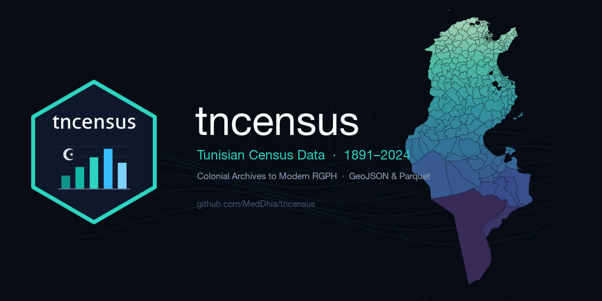
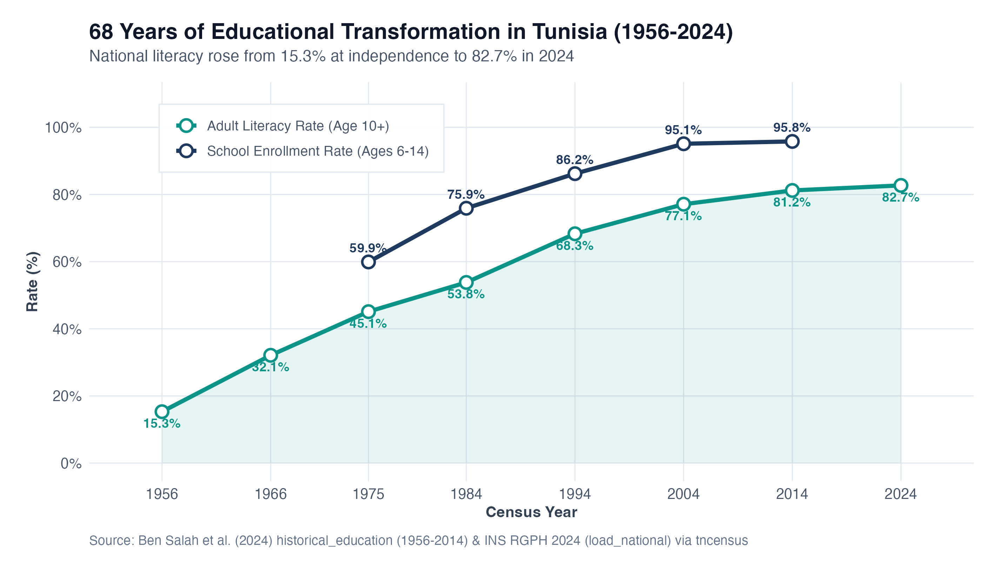

# tncensus 

[](https://github.com/MedDhia/tncensus/actions)
[](https://creativecommons.org/licenses/by/4.0/)
[](https://www.r-project.org/)
[](#datasets-summary)

**tncensus** is a unified R data package providing access to 133 years of Tunisian census data (1891–2024). It brings together contemporary General Population and Housing Censuses (**RGPH 2024**, **RGPH 2014**, **RGPH 2004**), a longitudinally harmonized **2014–2024 Delegation Panel**, pre-independence and post-independence historical censuses (1891–1984), and built-in **GeoJSON administrative boundaries** with multilingual place-name harmonization (Arabic, French, English, and historical transliterations).

<p align="center">
  
</p>

---

## Key Highlights

- **133 Years of Demographic Coverage (1891–2024):** Spanning colonial civil-control and caidat enumerations (1891–1956), post-independence national censuses (1956, 1966, 1984, 2004, 2014), and the newest 2024 decennial wave.
- **Harmonized 2014–2024 Delegation Panel (`census_panel`):** 281 delegations tracked across 45 socioeconomic indicators on unified 0–100 percentage and count scales, with explicit change metrics (`_2014`, `_2024`, `_change`).
- **Standardized English Naming Conventions:** All datasets and variables have been rigorously cleaned and standardized into predictable snake_case English schemas.
- **Fast Parquet Storage:** High-dimensional tables (28 disaggregated 2014 tables and full 2024 indicator suites) are backed by Zstandard-compressed Apache Parquet (`arrow`) for lightning-fast loads.
- **Built-in Administrative GeoJSON & Spatial Boundaries (`load_geojson()`):** Seamlessly load ready-to-map `sf` polygons for National (1), Regional (6), Governorate (24), and Delegation (264) tiers, enriched with Arabic (`_name_ar`), French (`_name`), and alternate romanizations (`_name_alt`).
- **Deep Historical & Colonial Archives:** Digitized and harmonized from [Ben Salah et al. (2024)](https://doi.org/10.1016/j.jce.2024.09.002), including 1,276 historical geonames, 1984–2014 boundary transition matrices, and colonial population tables.
- **Inequality Metrics:** Built-in functions for calculating Gini coefficients (`gini()`) and Generalized Entropy Theil inequality decompositions (`theil_decompose()`).

---

## Installation

You can install the development version of **tncensus** directly from GitHub:

```r
# Install devtools if not already available
if (!requireNamespace("devtools", quietly = TRUE)) {
  install.packages("devtools")
}

# Install tncensus
devtools::install_github("MedDhia/tncensus")
```

To take full advantage of spatial mapping capabilities, ensure `sf` and `ggplot2` are installed:

```r
install.packages(c("sf", "ggplot2", "arrow"))
```

---

## Datasets Summary

### 1. Contemporary Censuses & Harmonized Panel (2004–2024)

| Dataset / Function | Admin Level | Period | Dimensions | Description |
|:---|:---|:---:|:---:|:---|
| `census_panel` | Delegation | 2014–2024 | 281 × 144 | Harmonized decadal panel across 45 indicators (`_2014`, `_2024`, `_change`). |
| `delegation_crosswalk` | Delegation | 2014–2024 | 263 × 5 | Crosswalk mapping 2014 delegation names to 2024 administrative equivalents. |
| `codebook` | Metadata | 2014–2024 | 45 × 5 | Indicator descriptions, domains, units, and source formulas for the panel. |
| `load_delegations()` | Delegation | 2024 | 279 × 46 | Full RGPH 2024 delegation-level socioeconomic indicators (Parquet-backed). |
| `load_governorates()` | Governorate | 2024 | 24 × 46 | Full RGPH 2024 governorate-level socioeconomic aggregates. |
| `load_national()` | National | 2024 | 1 × 46 | National 2024 aggregates across all thematic indicators. |
| `load_sectors()` | Imada (Sector) | 2024 | 5,544 × 46 | Sector-level indicators (downloaded on demand via `download_sectors()`). |
| `rgph_master` | Delegation | 2014 | 264 × 169 | Primary 2014 census dataset covering demography, housing, and labor. |
| `rgph_load_sheet()` | Various | 2014 | 28 sheets | Disaggregated 2014 tables by sex, milieu (communal/rural), and facility distance. |
| `rgph2004` | Mixed (Del/Gov/Nat) | 2004 | 289 × 54 | RGPH 2004 population, literacy, education, labor force, and unemployment by sex. |

### 2. Post-Independence & Historical Censuses (1956–1984)

| Dataset | Admin Level | Period | Dimensions | Description |
|:---|:---|:---:|:---:|:---|
| `rgph1984_education` | Delegation × Age × Sex | 1984 | 55,720 × 6 | Tidy educational attainment, literacy, and school attendance rates. |
| `rgph1966_illiteracy` | Governorate | 1966 | 14 × 8 | Illiteracy and male school enrollment rates across 14 historical governorates. |
| `historical_education` | National | 1956–2014 | 7 × 3 | National literacy and 6–14 school enrollment rates across seven census waves. |

### 3. Colonial-Era Censuses (1891–1956)

| Dataset | Admin Level | Period | Dimensions | Description |
|:---|:---|:---:|:---:|:---|
| `colonial_tunisian_pop` | Locality / Caidat | 1926–1956 | 871 × 26 | Tunisian Muslim & Jewish populations across 871 localities over 5 censuses. |
| `colonial_european_pop` | Locality / Civil Control | 1891–1936 | 525 × 24 | French, Italian, Maltese, and other European populations over 8 censuses. |
| `colonial_age_caidat_1931` | Caidat | 1931 | 37 × 14 | Age pyramid and sex breakdown of the Tunisian population by caidat. |
| `colonial_age_controle_civil_1931` | Contrôle Civil | 1931 | 21 × 15 | Age pyramid and sex breakdown of the European population by civil control. |

### 4. Geographic Boundaries & Spatial Harmonization

| Dataset / Function | Geometry / Type | Features | Attributes | Description |
|:---|:---:|:---:|:---:|:---|
| `load_geojson("delegations")` | `sf` MultiPolygon | 264 | 20 | Delegation boundaries with Arabic, French, INS, SALB, and alternate names. |
| `load_geojson("governorates")` | `sf` MultiPolygon | 24 | 10 | Governorate boundaries with Arabic, French, and regional identifiers. |
| `load_geojson("regions")` | `sf` MultiPolygon | 6 | 6 | Six economic regions (North East, North West, Center East, etc.). |
| `load_geojson("national")` | `sf` MultiPolygon | 1 | 5 | National coastal & terrestrial boundary of Tunisia. |
| `delegation_codes_ins` | Crosswalk Table | 264 | 11 | Master INS crosswalk connecting 1984 codes, modern codes, UN SALB, & coords. |
| `historical_geonames` | Gazeteer Table | 1,276 | 14 | Historical place names mapped to modern equivalents, coordinates, & GeoNames. |
| `delegation_matrix_merged` | Transition Matrix | 217 | 5 | Time-consistent merged delegation units reconciling 1984–2014 boundary splits. |

---

## Quickstart & Guided Workflows

### 1. Exploring 10-Year Socioeconomic Changes (2014–2024 Panel)

The `census_panel` dataset harmonizes 45 indicators between the 2014 and 2024 censuses:

```r
library(tncensus)

# Load harmonized panel
data("census_panel")

# Top 5 delegations by expansion in higher education attainment (% points)
top_higher_ed <- census_panel[order(-census_panel$pct_higher_ed_change), ]
head(top_higher_ed[, c("delegation_fr_2024", "governorate", 
                       "pct_higher_ed_2014", "pct_higher_ed_2024", 
                       "pct_higher_ed_change")], 5)

# Regional averages in piped drinking water (SONEDE) expansion
aggregate(
  cbind(pct_sonede_water_2014, pct_sonede_water_2024, pct_sonede_water_change) ~ region_2024,
  data = census_panel,
  FUN = mean, na.rm = TRUE
)
```

<p align="center">
  
</p>

---

### 2. Spatial Mapping with `sf` and `ggplot2`

All administrative boundaries are available as clean GeoJSON layers and can be loaded directly with `load_geojson()`:

```r
library(tncensus)
library(ggplot2)
library(sf)

# 1. Load delegation boundaries
del_sf <- load_geojson("delegations")

# 2. Join with the 2014-2024 census panel by 2024 delegation name
del_map <- merge(del_sf, census_panel, 
                 by.x = "delegation_name_2024", 
                 by.y = "delegation_fr_2024", 
                 all.x = TRUE)

# 3. Plot 2024 higher education attainment across all 264 delegations
ggplot(del_map) +
  geom_sf(aes(fill = pct_higher_ed_2024), color = "white", linewidth = 0.08) +
  scale_fill_viridis_c(
    option = "mako",
    direction = -1,
    name = "Share (%)",
    na.value = "grey90"
  ) +
  labs(
    title = "Higher Education Attainment in Tunisia (2024)",
    subtitle = "Population aged 10+ with university degree across 264 delegations",
    caption = "Source: Institut National de la Statistique (INS) via tncensus"
  ) +
  theme_void() +
  theme(
    plot.title = element_text(face = "bold", size = 14),
    plot.subtitle = element_text(color = "grey40", size = 11),
    legend.position = "right"
  )
```

<p align="center">
  
</p>

---

### 3. RGPH 2024 Indicators & Inequality Decompositions

Use the RGPH 2024 search tools and inequality indices:

```r
# Search for indicators related to internet or utilities
search_indicator("internet")
search_indicator("SONEDE")

# Load 2024 delegation-level data
del_2024 <- load_delegations()

# Calculate the national Gini index for piped gas connections
gini_gas <- gini(del_2024[["utility_connections.total.natural_gas"]])
cat(sprintf("Gini coefficient for natural gas access: %.3f\n", gini_gas))

# Decompose inequality across regions (between-group vs within-group)
theil_water <- theil_decompose(
  x = del_2024[["utility_connections.total.SONEDE"]],
  group = del_2024[["region"]]
)

cat(sprintf("Total Theil T: %.3f\n", theil_water$total))
cat(sprintf("Between-Region Share: %.1f%%\n", theil_water$pct_between))
```

---

### 4. 68 Years of National Education Expansion (1956–2024)

Connect the post-independence census series (`historical_education`) with modern census results:

```r
# National education progress since independence
data("historical_education")
print(historical_education)

# Append 2024 national literacy rate
nat_2024 <- load_national()
modern_literacy <- (1 - nat_2024[["illiteracy.all.total.total.total"]]) * 100

# Combine for long-run trend
hist_trend <- rbind(
  data.frame(year = historical_education$year, literacy_rate = historical_education$literacy_rate),
  data.frame(year = 2024, literacy_rate = round(modern_literacy, 1))
)

print(hist_trend)
```

<p align="center">
  
</p>

---

### 5. Historical Place Name Resolution & Geo-Harmonization

Colonial-era records often use obsolete or phonetically transliterated place names. Use `historical_geonames` to resolve them to modern coordinates and entities:

```r
data("historical_geonames")

# Find historical entries for a colonial name variant
sub <- subset(historical_geonames, grepl("Ferryville|Menzel Bourguiba", locality_name_source, ignore.case = TRUE))
sub[, c("locality_name_source", "locality_name_modern", "delegation_1956", "lat", "lon")]
```

To bridge changes in delegation boundaries caused by administrative splits between 1984 and 2014, use `delegation_matrix_merged`:

```r
data("delegation_matrix_merged")
head(delegation_matrix_merged, 10)
```

---

## Multilingual Support & Geographic Harmonization

Because Tunisian census sources and administrative records alternate between Arabic, French, and various phonetic transliterations, all GeoJSON boundary sets in **tncensus** come pre-equipped with multiple identifier columns:

- `delegation_name`: Standard French administrative name (e.g., `"Carthage"`).
- `delegation_name_ar`: Standard Arabic script name (e.g., `"قرطاج"`).
- `delegation_name_2014` & `delegation_name_2024`: Names as recorded in respective census publications.
- `delegation_name_alt`: Comma-separated alternative transliterations and historical spellings (e.g., `"Djebel Jelloud, Jebel Jelloud, Jabal Jallud"`).
- `delegation_id_salb_un`: United Nations Second Administrative Level Boundaries (SALB) code.
- `delegation_id_1984`: Historical 1984 census code.

---

## Data Sources & Citation

### Institutional Data Collector

All contemporary census data (2014, 2024, and earlier national publications) are produced and published by the **Institut National de la Statistique (INS)**, Republic of Tunisia:
- Website: [https://www.ins.tn/](https://www.ins.tn/)
- Portal: [Statistiques Tunisie Data Portal](https://dataportal.ins.tn/)

### Academic Research & Historical Digitization

The digitized colonial (1891–1956) and historical post-independence census series (1966–2004), as well as the historical geographic crosswalks, were compiled, cleaned, and published in the replication package of:

> **Ben Salah, E., Boughzala, M. S., & Zouabi, O. (2024).** *Historical census and educational data of Tunisia (1891–2014)*. **Journal of Comparative Economics**, 52(4), 1013–1032. [https://doi.org/10.1016/j.jce.2024.09.002](https://doi.org/10.1016/j.jce.2024.09.002)

If you use the historical or colonial datasets (`colonial_*`, `rgph1966_illiteracy`, `rgph1984_education`, `rgph2004`, `historical_education`, `historical_geonames`, or `delegation_matrix_*`), please cite **Ben Salah et al. (2024)**.

### Citing the `tncensus` Package

To cite the **tncensus** package in publications:

```bibtex
@manual{tncensus2024,
  title  = {tncensus: Tunisian Census Data (1891--2024 Censuses and Harmonized Panel)},
  author = {Mohamed Dhia Hammami},
  year   = {2024},
  note   = {R package version 1.0.0},
  url    = {https://github.com/MedDhia/tncensus}
}
```

---

## License

This package and its documentation are distributed under the **Creative Commons Attribution 4.0 International License (CC BY 4.0)**. You are free to share and adapt the material for any purpose, provided appropriate credit is given.

---

## Contributing & Bug Reports

Contributions, bug reports, and suggestions are welcome! Please open an issue or submit a pull request on GitHub at [https://github.com/MedDhia/tncensus/issues](https://github.com/MedDhia/tncensus/issues).
