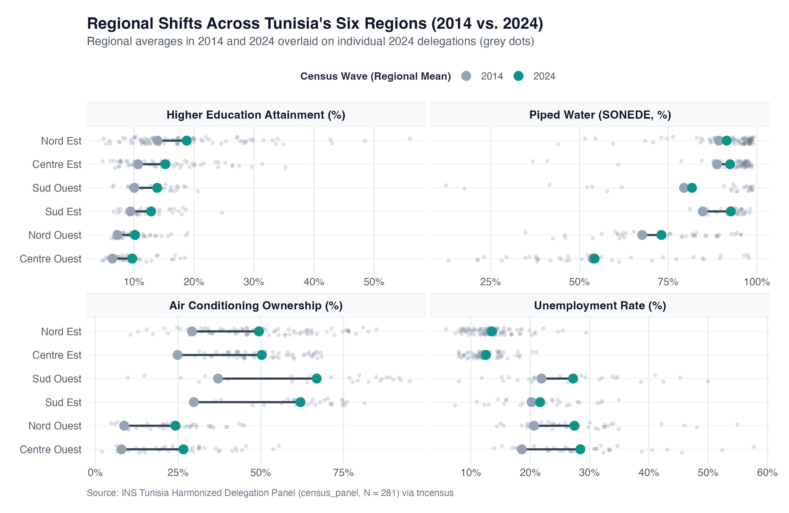
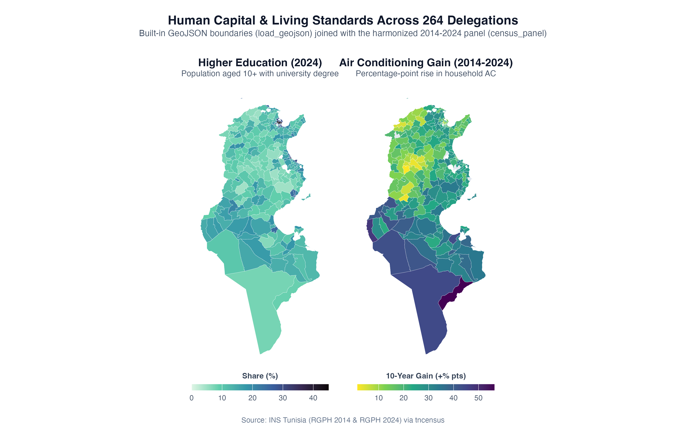

# tncensus 

[](https://github.com/MedDhia/tncensus/actions)
[](https://creativecommons.org/licenses/by/4.0/)
[](https://www.r-project.org/)
[](#datasets-summary)

**tncensus** is a unified R data package providing access to 133 years of Tunisian census data (1891–2024). It brings together contemporary General Population and Housing Censuses (**RGPH 2024**, **RGPH 2014**, **RGPH 2004**), a longitudinally harmonized **2014–2024 Delegation Panel**, pre-independence and post-independence historical censuses (1891–1984), and built-in **GeoJSON administrative boundaries** with multilingual place-name harmonization (Arabic, French, English, and historical transliterations).

<p align="center">
  
</p>

---

## Key Highlights

- **133 Years of Demographic Coverage (1891–2024):** Spanning colonial civil-control and caidat enumerations (1891–1956), post-independence national censuses (1956, 1966, 1984, 2004, 2014), and the newest 2024 decennial wave.
- **Harmonized 2014–2024 Delegation Panel (`census_panel`):** 281 delegations tracked across 45 socioeconomic indicators on unified 0–100 percentage and count scales, with explicit change metrics (`_2014`, `_2024`, `_change`).
- **Standardized English Naming Conventions:** All datasets and variables have been rigorously cleaned and standardized into predictable snake_case English schemas.
- **Fast Parquet Storage:** High-dimensional tables (28 disaggregated 2014 tables and full 2024 indicator suites) are backed by Zstandard-compressed Apache Parquet (`arrow`) for lightning-fast loads.
- **Built-in Administrative GeoJSON & Spatial Boundaries (`load_geojson()`):** Seamlessly load ready-to-map `sf` polygons for National (1), Regional (6), Governorate (24), and Delegation (264) tiers, enriched with Arabic (`_name_ar`), French (`_name`), and alternate romanizations (`_name_alt`).
- **Deep Historical & Colonial Archives:** Digitized and harmonized from [Ben Salah et al. (2024)](https://doi.org/10.1016/j.jce.2024.09.002), including 1,276 historical geonames, 1984–2014 boundary transition matrices, and colonial population tables.
- **Original Colonial Census and Statistical Publications (`load_colonial_census()`):** 313 tables (262,965 cells) transcribed from Gallica scans: the 1906 European and 1931 indigenous census volumes (down to 333 localities and 804 cheikhats), and the *Démographie* chapter of 12 *Statistique générale de la Tunisie* yearbooks, which reprint the 1921, 1926, 1931 and 1936 censuses and give yearly births, deaths, marriages, expulsions, naturalisations, foreigners' movements and recruitment (1902–1939), plus hospital activity, Tunis mortality by cause and nationality, the public-assistance budget, school enrolment by nationality and sex (with a pupil series from 1885), municipal finances, the courts, the prisons, land registration, the posts and telegraphs, public works and mines, the state budget, debt and taxes, colonisation lotissements, crops, mutual credit, labour, foreign trade, research institutions, and rainfall. Every table is checked against its printed totals and its reprints, and every cell keeps its page and Gallica view, so it can be checked against the scan.
- **Inequality Metrics:** Built-in functions for calculating Gini coefficients (`gini()`) and Generalized Entropy Theil inequality decompositions (`theil_decompose()`).

---

## Installation

You can install the development version of **tncensus** directly from GitHub:

```r
# Install devtools if not already available
if (!requireNamespace("devtools", quietly = TRUE)) {
  install.packages("devtools")
}

# Install tncensus
devtools::install_github("MedDhia/tncensus")
```

To take full advantage of spatial mapping capabilities, ensure `sf` and `ggplot2` are installed:

```r
install.packages(c("sf", "ggplot2", "arrow"))
```

---

## Datasets Summary

### 1. Contemporary Censuses & Harmonized Panel (2004–2024)

| Dataset / Function | Admin Level | Period | Dimensions | Description |
|:---|:---|:---:|:---:|:---|
| `census_panel` | Delegation | 2014–2024 | 281 × 144 | Harmonized decadal panel across 45 indicators (`_2014`, `_2024`, `_change`). |
| `delegation_crosswalk` | Delegation | 2014–2024 | 263 × 5 | Crosswalk mapping 2014 delegation names to 2024 administrative equivalents. |
| `codebook` | Metadata | 2014–2024 | 45 × 5 | Indicator descriptions, domains, units, and source formulas for the panel. |
| `load_delegations()` | Delegation | 2024 | 279 × 46 | Full RGPH 2024 delegation-level socioeconomic indicators (Parquet-backed). |
| `load_governorates()` | Governorate | 2024 | 24 × 46 | Full RGPH 2024 governorate-level socioeconomic aggregates. |
| `load_national()` | National | 2024 | 1 × 46 | National 2024 aggregates across all thematic indicators. |
| `load_sectors()` | Imada (Sector) | 2024 | 5,544 × 46 | Sector-level indicators (downloaded on demand via `download_sectors()`). |
| `rgph_master` | Delegation | 2014 | 264 × 169 | Primary 2014 census dataset covering demography, housing, and labor. |
| `rgph_load_sheet()` | Various | 2014 | 28 sheets | Disaggregated 2014 tables by sex, milieu (communal/rural), and facility distance. |
| `rgph2004` | Mixed (Del/Gov/Nat) | 2004 | 289 × 54 | RGPH 2004 population, literacy, education, labor force, and unemployment by sex. |

### 2. Post-Independence & Historical Censuses (1956–1984)

| Dataset | Admin Level | Period | Dimensions | Description |
|:---|:---|:---:|:---:|:---|
| `rgph1984_education` | Delegation × Age × Sex | 1984 | 55,720 × 6 | Tidy educational attainment, literacy, and school attendance rates. |
| `rgph1966_illiteracy` | Governorate | 1966 | 14 × 8 | Illiteracy and male school enrollment rates across 14 historical governorates. |
| `historical_education` | National | 1956–2014 | 7 × 3 | National literacy and 6–14 school enrollment rates across seven census waves. |

### 3. Colonial-Era Censuses (1891–1956)

| Dataset | Admin Level | Period | Dimensions | Description |
|:---|:---|:---:|:---:|:---|
| `colonial_tunisian_pop` | Locality / Caidat | 1926–1956 | 871 × 26 | Tunisian Muslim & Jewish populations across 871 localities over 5 censuses. |
| `colonial_european_pop` | Locality / Civil Control | 1891–1936 | 525 × 24 | French, Italian, Maltese, and other European populations over 8 censuses. |
| `colonial_age_caidat_1931` | Caidat | 1931 | 37 × 14 | Age pyramid and sex breakdown of the Tunisian population by caidat. |
| `colonial_age_controle_civil_1931` | Contrôle Civil | 1931 | 21 × 15 | Age pyramid and sex breakdown of the European population by civil control. |

#### Tables from the original 1906 and 1931 census publications

`load_colonial_census()` loads tables transcribed from two census volumes digitized on [Gallica](#archival-scans-from-gallica-bnf); `colonial_census_tables()` lists all 39. Tables are tidy (one row per printed cell), keep place names as printed (canonical names and coordinates are in `colonial_place_crosswalk`), and give each cell's printed page and Gallica view. See [`data-raw/colonial_census/CODEBOOK.md`](data-raw/colonial_census/CODEBOOK.md) for every column and code.

| Table | Admin Level | Rows | Description |
|:---|:---|---:|:---|
| `eur1906_t1_circonscription_nationality` | Contrôle Civil | 114 | Europeans by nationality (French, Italian, Maltese, Spanish, Greek, other), 1906. |
| `eur1906_t2_locality_nationality` | Locality | 1,998 | Europeans by nationality in 333 localities, 1906. |
| `eur1906_t3_birthplace` | National | 139 | Europeans by place of birth (French départements, foreign countries, Italian provinces). |
| `eur1906_t4_residence_duration` | Contrôle Civil | 1,368 | Europeans by length of residence in Tunisia and nationality. |
| `eur1906_t5_sex_age_marital` | National | 336 | Europeans by nationality, sex, age group and marital status. |
| `eur1906_t6_profession_nationality`, `eur1906_t7_profession_circonscription` | National / Contrôle Civil | 192 / 3,648 | Europeans by profession, active vs family member, sex and nationality. |
| `eur1906_t8_instruction` | National | 18 | Literacy and knowledge of French by nationality. |
| `eur1906_ta_*` … `eur1906_tg_*` | Contrôle Civil / Locality | 2,234 | Analysis tables: densities, French population 1891–1906 by district, locality and birthplace, growth coefficients, French by origin, occupations 1901/1906. |
| `eur1906_text_*` | National | 578 | Twelve small tables printed in the commentary (sex, age, marital status, birthplace, occupations). |
| `ind1931_t1_controle_nationality`, `ind1931_t2_caidat_nationality` | Contrôle Civil / Caidat | 280 / 518 | Muslim and Jewish population by nationality (Tunisian, Algerian, Moroccan, Sudanese, Syrian, Tripolitanian, other), 1931. |
| `ind1931_t3_cheikhat_nationality` | Cheikhat | 11,256 | The same for 804 cheikhats in 37 caidats. |
| `ind1931_t4_*`, `ind1931_t4annex_*` | Contrôle Civil / National | 80 / 28 | 1926 vs 1931, by district and by nationality. |
| `ind1931_t5_caidat_sex_age`, `ind1931_t5annex_*` | Caidat / National | 296 / 16 | Men, women, boys and girls, by religion; 1926 vs 1931. |
| `ind1931_t6_caidat_profession`, `ind1931_t6annex_*` | Caidat / National | 592 / 32 | Occupations of men aged 18 and over, by religion; 1926 vs 1931. |
| `ind1931_t7_communes`, `ind1931_t7annex_communes_1921_1931` | Commune | 116 / 174 | Muslim and Jewish population of the 58 communes; 1921, 1926 and 1931. |
| `ind1931_t8_localities` | Locality | 562 | Non-commune localities with more than 25 households. |

#### Tables from the *Statistique générale de la Tunisie* yearbooks (1918–1939)

The *Démographie* chapter of 12 annual editions (1922–1930, 1935, 1936, 1939; see [`data-raw/yearbook_demography/EDITIONS.md`](data-raw/yearbook_demography/EDITIONS.md)). These tables share `load_colonial_census()`; their rows carry the edition (`census = "sgt1927"` etc.) and its `gallica_ark`. Census tables reprinted in several editions are stored once and were compared cell by cell with the reprints; yearly series take each year from the latest edition that prints it.

| Tables | Admin Level | Rows | Description |
|:---|:---|---:|:---|
| `cens1921_*` (16 tables) | Contrôle Civil / Circonscription / Town | 1,741 | 1921 census: population and density, French by birthplace 1891–1921, naturalised French, foreigners and Italians by origin, Europeans by age, sex, marital status and profession, illiterates, 1911 vs 1921, Europeans 1881–1921, towns. |
| `cens1926_*` (9 tables) | Contrôle Civil / Commune / Town | 2,706 | 1926 census: Europeans by nationality, Muslims and Jews by contrôle; French and foreigners by birthplace; Italians by region; age, sex and marital status; profession; instruction; towns over 5,000; the 59 communes with decree dates. |
| `cens1931_*`, `cens1936_*` (6 tables) | Contrôle Civil / Circonscription / Town | 1,824 | 1931 and 1936 censuses: population by contrôle, Europeans compared with the previous census, towns over 5,000. |
| `vital_*` (6 tables) | Contrôle Civil / National | 2,674 | Muslim and Jewish births and deaths by contrôle (1918–1939); European marriages, births and deaths by nationality; mixed marriages. |
| `expulsions_nationality`, `foreigners_movements` | National | 2,048 | Expulsions by nationality (1913–1934); foreigners' arrivals and departures by nationality (1917–1939). |
| `naturalisations_*` (8 tables) | National | 1,793 | Naturalisations granted, civil status, age, profession and nationality of the naturalised (1922–1939), and two long series by nationality (1891–1930, 1891–1939). |
| `health_*` population (20 tables) | Tunis / Hospital / Interior town | 12,010 | Health chapter, population: Tunis deaths by month, cause and nationality, and natality vs mortality; admissions, discharges, deaths, wards and consultations of the French civil, Sadiki and Rabta hospitals; diseases treated by nationality; provincial hospitals and dispensaries; Manouba mental hospital (1905–1939). |
| `health_*` finance (14 tables) | National / Hospital / Society | 10,992 | Health chapter, finance: public-assistance receipts, expenditure and credits; child-protection credits; accounts of subsidised charities; Pasteur and Arloing institute budgets and doses distributed; provincial hospitals' finances; cost of a patient-day (1912–1939). |
| `education_*` (16 tables) | National / Establishment | 9,723 | Public-instruction chapter: total pupils; examination candidates and passes by exam, nationality and sex; secondary, higher and special establishments; primary-education totals; school population by type of school, nationality and sex (yearly series 1919–1939, quinquennial from 1885); vocational education; libraries, canteens, Arabic courses, music and commerce schools. |
| `education_schools` | School | 14,960 | School-by-school lists of public primary and private schools for 1922 and 1930 (382 and 497 schools): locality, classes, staff, and pupils by sex and nationality. |
| `communes_*` (19 tables) | Commune | 27,005 | Communes chapter: receipts and expenditure of each commune (1918–1938); communal property (1922–1937); building permits (1922–1936) and building values (1939); café terraces and street stalls (1922–1935); municipal loans and Tunis city bonds (1922–1929); slaughter dues per animal (1922–1930); water networks and sales (1913–1939); Tunis gas consumption (1913–1939) and gas works (1934–1939); electricity networks (1922–1930), production and distribution (1935–1939). |
| `justice_*` (16 tables) | Court / Caidat | 6,335 | Justice chapter: French criminal, civil and commercial cases (1913–1939); Ouzara, regional courts, caids, prosecutors, investigation, indictment and revision chambers (1918–1930); appeal rates; court fees and fines; the 1935–1939 Tunisian courts. |
| `prisons_*` (9 tables) | Prison / National | 18,032 | Prisons chapter, complete: prison population, entries, releases and days of detention (1913–1939); entries and releases by prison and kind, men and women (every edition); condemned prisoners by nationality, age, sex and penal category, and by offence and sentence (1922–1939); deaths by prison and disease, transfers, guard staff against the maximum daily population (1922–1935); days of work by prison (1922–1930, 1935); expenditure and cost per day of detention (1922–1935; this table stores the printed totals too, so don't add them to the items). |
| `property_*` (13 tables) | Seat of the Tribunal mixte / Contrôle civil / National | 6,538 | Land registration (Tribunal mixte immobilier and Conservation de la propriété foncière), every edition: cases and pending requisitions by seat and stage; results by legal status (melk, enzel, habous), urban or rural, areas (hectares), enzel rents and mortgages; oppositions; claimants by status and nationality; requisitions filed by nationality, declared value bracket, area and value, and titles issued, yearly 1910–1939; cumulative registry summary; transfers of registered properties by contrôle civil (1939). Opening multi-year periods (e.g. 1886-1909) overlap the single years and must not be summed with them. |
| `posts_*` (7 tables) | National | 6,100 | Posts, telegraphs and telephones, yearly 1913–1939 (each year from the latest edition printing it): network (offices, lines in km), traffic (letters, parcels, telegrams, telephone calls, money orders, postal cheques), revenue and expenditure, money orders to and from France and Italy, savings-bank accounts opened. Also the dated exchange rates applied to international money orders for eight countries, April 1915 to November 1930 (from the 1930 printing, compared with every earlier one). |
| `publicworks_*` (12 tables) | Network / line / National | 4,048 | Public works and mines, yearly 1913–1939: railway operating results by network and line (length, receipts, passengers, goods) and their finances under the 1922 Convention; roads; drinking-water, irrigation, artesian-well and sanitation works; mining permits, mines worked, ore exports, phosphates, zinc, lead and iron ore (tonnage and value); a detailed mining table for each edition's own year; registered vehicles and Tunis airport traffic (1936–1939). Several failed totals cannot be pinned to one cell; the notes list them. |
| `finance_*` (15 tables) | Caïdat / National | 52,468 | Finances chapter: the Regency's annual budget, realised receipts by budget chapter and expenditure as finally settled by service, exercices 1915–1938 (1930–1931 not printed; 1932 is a 9-month exercice); the public debt since 1884 (charges and payments by loan, amounts remaining due); taxpayers of the patente by caïdat and class of profit (1922–1930) and by caïdat with mean profit (1935–1939); taxpayers of the personal tax by caïdat and nationality (1922–1930); animals on the livestock-tax rolls by caïdat, species and age class, European and indigenous rolls (1922–1926); areas sown subject to the achour (tithe on cereals) by caïdat, crop and roll, by yield class in 1922–1925 (hectares; 1935 national totals only); date palms and olive trees on the canoun rolls by caïdat and age, by tariff category, and taxed or not for Europeans and Tunisians (1922–1930, 1935). |
| `colonisation_*` (16 tables) | Lotissement / Contrôle civil / National | 7,326 | Colonisation chapter: state lotissements sold to settlers with an obligation of personal settlement, lot by lot (area, lots by type, contrôle civil; every edition, 1913–1939), land for planting, urban, industrial and summer lotissements, the summary by origin of the land, the settlement of Tunisians on the land (1920–1939) and definitive sales to Tunisian allottees, the 1935 regrouping operations, and the colonisation fund 1900–1928. Lists are revised from edition to edition, so each edition is kept (filter on `census`). In 1922–1923 also: lands delivered and lots sold by contrôle civil since 1893, sales with an obligation to plant (authorisations and definitive sales by nationality), and habous cessions by substitution and à enzel, by year and by contrôle. |
| `mutuality_*` (7 tables) | Institution / National | 2,422 | Economic institutions: agricultural mutual credit (local French and Tunisian caisses, bills discounted), yearly 1913–1939; the central farmers' cooperative (shares, goods delivered, loans, 1913–1929) and its capital with the motor-cultivation cooperative (1921–1939). Also agricultural mutual insurance (fire, hail, accidents), 1913–1935, and the Office public de crédit agricole indigène, 1925–1934. Also the Tunisian provident societies (loans by type, cancellations, recoveries, balance due), 1913–1939. Also the balance sheets of the Banque populaire française, the Coopérative tunisienne de crédit and « La Maison Française » (1926–1930; item codes follow each printed label). |
| `labour_*` (14 tables) | National | 4,555 | Labour and social welfare chapter (1925–1939 editions): low-cost housing (dwellings built, state subsidies and capital invested); industrial accidents by occupational category and nationality, by outcome and by material cause (each edition); strikes yearly 1916–1939 and strike by strike; the French placement office (applications, offers, placements by trade); cost-of-living indices (July 1914 = 100), 1915–1939; immigrant workers' contract visas (1939). The `labour_early_*` tables give industrial accidents for 1922–1924 (printed in the economic-institutions chapter) with the same columns and codes. The 1939 lists of collective agreements and arbitration awards are text only and are kept in `data-raw`. |
| `commerce_*` (15 tables) | Commune / Port / Country / National | 6,672 | Commerce chapter, from the 1922–1924 editions so far: imports and exports by class of product, by category of the customs nomenclature, by origin group (France and Algeria vs foreign countries and colonies) and by country, values in francs, 1913–1924; import duties by product category and export duties by product, 1913–1924. Navigation: ships, tonnage, goods and passengers entered and cleared by port and by flag (each edition's year) and yearly 1913–1924, coastal trade, and fisheries by nationality; animals slaughtered by commune and species (1922–1924); cereal import, export and balance by campaign, 1912-13 to 1923-24 (quintals); cereal stocks available by harvest and average consumption per inhabitant; olive oil and wine trade balance, stocks and average consumption. Prices, the product tables and the 1925–1939 editions are in progress. |
| `research_*` (11 tables) | Institution / National | 5,359 | Teaching and research institutions: the École coloniale d'agriculture (pupils by origin, graduating classes, enrolment by year), the botanical service (variety trials, pedigree seed sold and produced, trees and plants sold), the chemistry laboratories of Tunis and Sfax (analyses by product and requester), and from 1935 the Institut Pasteur (budget, work, veterinary service) and the Institut Arloing (microbiological analyses). Meteorology is in progress. |
| `meteo_*` (3 tables) | Station / National | 17,948 | Meteorology: rainfall in millimetres and number of rainy days by station and month, solar years 1935 and 1936 (about 260 stations in 1936, 350 in 1935), with observation codes (`obs`: traces, incomplete, days not observed). In 1935 the November column runs into the binding: 87 cells are derived from the printed annual totals (`derived_from_totals`) and 19 are illegible. Also rainfall by season for the agricultural year 1929-30 at 313 stations, with the 1901–1925 normal where printed. The rest of the 1922–1930 meteorology pages are in progress. |
| `agriculture_*` (14 tables) | Caïdat / Contrôle civil / Zone / National | 11,979 | Agriculture chapter: land area (territorial, productive, arable, forest, rangeland; each edition); area, production and yield of every crop, yearly 1913–1939 (each year from the latest edition printing it; revisions listed in the notes); cereals by zone (North, Centre and South), 1917–1939. Also: areas sown and taxed by yield class, European and indigenous farmers (1914–1925); cereal areas of European and indigenous farmers, 1917–1939; vine growers and vineyards by contrôle and nationality (1922–1925); olive trees by caïdat or region (each edition). Date palms by caïdat and age (1936, 1939); livestock by species, contrôle and caïdat, European and indigenous owners (1927–1939). Forests: area delimited and boundary-marked 1903–1930, the domain under forest management 1931–1939 (a different series), products sold and their cash revenue (each edition), and offences and fires (1922–1927; burnt area stored in its printed hectare, are and centiare parts). |
| `recruitment_*` (5 tables) | National | 1,132 | French recruitment (allocation, education, draft boards, classes 1902–1939) and indigenous conscription (1913–1939). |

### 4. Geographic Boundaries & Spatial Harmonization

| Dataset / Function | Geometry / Type | Features | Attributes | Description |
|:---|:---:|:---:|:---:|:---|
| `load_geojson("delegations")` | `sf` MultiPolygon | 264 | 20 | Delegation boundaries with Arabic, French, INS, SALB, and alternate names. |
| `load_geojson("governorates")` | `sf` MultiPolygon | 24 | 10 | Governorate boundaries with Arabic, French, and regional identifiers. |
| `load_geojson("regions")` | `sf` MultiPolygon | 6 | 6 | Six economic regions (North East, North West, Center East, etc.). |
| `load_geojson("national")` | `sf` MultiPolygon | 1 | 5 | National coastal & terrestrial boundary of Tunisia. |
| `delegation_codes_ins` | Crosswalk Table | 264 | 11 | Master INS crosswalk connecting 1984 codes, modern codes, UN SALB, & coords. |
| `historical_geonames` | Gazeteer Table | 1,276 | 14 | Historical place names mapped to modern equivalents, coordinates, & GeoNames. |
| `colonial_place_crosswalk` | Crosswalk Table | 2,489 | 16 | Every place name printed in the `load_colonial_census()` tables, with canonical spelling, contrôle civil and caidat, linked to `historical_geonames` (1,554 links, 1,532 with coordinates). |
| `delegation_matrix_merged` | Transition Matrix | 217 | 5 | Time-consistent merged delegation units reconciling 1984–2014 boundary splits. |

---

## Quickstart & Guided Workflows

### `tidycensus` & `tigris`-Style Interface

If you are familiar with US Census R packages (`tidycensus`, `tigris`), **tncensus** provides drop-in equivalent functions for Tunisia:

```r
library(tncensus)

# 1. Browse available variables (like tidycensus::load_variables)
vars_2024 <- load_variables(2024)
subset(vars_2024, grepl("SONEDE|natural_gas", name))

# 2. Query tidy census data with optional sf geometry (like tidycensus::get_decennial)
tunis_sf <- get_tn_census(
  geography   = "delegation",
  variables   = c(sonede = "utility_connections.total.SONEDE",
                  gas    = "utility_connections.total.natural_gas"),
  year        = 2024,
  governorate = "Tunis",
  output      = "tidy",
  geometry    = TRUE
)

# 3. Query multi-year 2014-2024 panel data directly in wide or tidy format
panel_edu <- get_tn_census(
  geography = "delegation",
  variables = c("pct_higher_ed", "unemployment_rate"),
  year      = c(2014, 2024),
  output    = "wide"
)

# 4. Load filtered administrative boundaries (like tigris::counties / tracts)
ne_govs   <- tn_governorates(region = "North East")   # 7 governorates
sfax_dels <- tn_delegations(governorate = "Sfax")     # Sfax delegations
```

---

### 1. Exploring 10-Year Socioeconomic Changes (2014–2024 Panel)

The `census_panel` dataset harmonizes 45 indicators between the 2014 and 2024 censuses:

```r
library(tncensus)

# Load harmonized panel
data("census_panel")

# Top 5 delegations by expansion in higher education attainment (% points)
top_higher_ed <- census_panel[order(-census_panel$pct_higher_ed_change), ]
head(top_higher_ed[, c("delegation_fr_2024", "governorate", 
                       "pct_higher_ed_2014", "pct_higher_ed_2024", 
                       "pct_higher_ed_change")], 5)

# Regional averages in piped drinking water (SONEDE) expansion
aggregate(
  cbind(pct_sonede_water_2014, pct_sonede_water_2024, pct_sonede_water_change) ~ region_2024,
  data = census_panel,
  FUN = mean, na.rm = TRUE
)
```

<p align="center">
  
</p>

---

### 2. Spatial Mapping with `sf` and `ggplot2`

All administrative boundaries are available as clean GeoJSON layers and can be loaded directly with `load_geojson()`:

```r
library(tncensus)
library(ggplot2)
library(sf)

# 1. Load delegation boundaries
del_sf <- load_geojson("delegations")

# 2. Join with the 2014-2024 census panel by 2024 delegation name
del_map <- merge(del_sf, census_panel, 
                 by.x = "delegation_name_2024", 
                 by.y = "delegation_fr_2024", 
                 all.x = TRUE)

# 3. Plot 2024 higher education attainment across all 264 delegations
ggplot(del_map) +
  geom_sf(aes(fill = pct_higher_ed_2024), color = "white", linewidth = 0.08) +
  scale_fill_viridis_c(
    option = "mako",
    direction = -1,
    name = "Share (%)",
    na.value = "grey90"
  ) +
  labs(
    title = "Higher Education Attainment in Tunisia (2024)",
    subtitle = "Population aged 10+ with university degree across 264 delegations",
    caption = "Source: Institut National de la Statistique (INS) via tncensus"
  ) +
  theme_void() +
  theme(
    plot.title = element_text(face = "bold", size = 14),
    plot.subtitle = element_text(color = "grey40", size = 11),
    legend.position = "right"
  )
```

<p align="center">
  
</p>

---

### 3. RGPH 2024 Indicators & Inequality Decompositions

Use the RGPH 2024 search tools and inequality indices:

```r
# Search for indicators related to internet or utilities
search_indicator("internet")
search_indicator("SONEDE")

# Load 2024 delegation-level data
del_2024 <- load_delegations()

# Calculate the national Gini index for piped gas connections
gini_gas <- gini(del_2024[["utility_connections.total.natural_gas"]])
cat(sprintf("Gini coefficient for natural gas access: %.3f\n", gini_gas))

# Decompose inequality across regions (between-group vs within-group)
theil_water <- theil_decompose(
  x = del_2024[["utility_connections.total.SONEDE"]],
  group = del_2024[["region"]]
)

cat(sprintf("Total Theil T: %.3f\n", theil_water$total))
cat(sprintf("Between-Region Share: %.1f%%\n", theil_water$pct_between))
```

---

### 4. 68 Years of National Education Expansion (1956–2024)

Connect the post-independence census series (`historical_education`) with modern census results:

```r
# National education progress since independence
data("historical_education")
print(historical_education)

# Append 2024 national literacy rate
nat_2024 <- load_national()
modern_literacy <- (1 - nat_2024[["illiteracy.all.total.total.total"]]) * 100

# Combine for long-run trend
hist_trend <- rbind(
  data.frame(year = historical_education$year, literacy_rate = historical_education$literacy_rate),
  data.frame(year = 2024, literacy_rate = round(modern_literacy, 1))
)

print(hist_trend)
```

<p align="center">
  
</p>

---

### 5. Historical Place Name Resolution & Geo-Harmonization

Colonial-era records often use obsolete or phonetically transliterated place names. Use `historical_geonames` to resolve them to modern coordinates and entities:

```r
data("historical_geonames")

# Find historical entries for a colonial name variant
sub <- subset(historical_geonames, grepl("Ferryville|Menzel Bourguiba", locality_name_source, ignore.case = TRUE))
sub[, c("locality_name_source", "locality_name_modern", "delegation_1956", "lat", "lon")]
```

To bridge changes in delegation boundaries caused by administrative splits between 1984 and 2014, use `delegation_matrix_merged`:

```r
data("delegation_matrix_merged")
head(delegation_matrix_merged, 10)
```

### 6. Working with the Original Colonial Census and Yearbook Tables

```r
# List the 313 transcribed tables
idx <- colonial_census_tables()
idx[, c("table", "title_en", "n_rows")]

# Europeans by contrôle civil and nationality, 1906 (cross-tabulated)
t1 <- load_colonial_census("eur1906_t1_circonscription_nationality")
xtabs(value ~ controle_civil + nationality, data = t1)

# Jewish population by cheikhat in the caidat of Djerba, 1931.
# Drop the four Tunis-Ville rows that repeat Tunis-Banlieue groups first.
ch <- load_colonial_census("ind1931_t3_cheikhat_nationality")
ch <- ch[ch$duplicate == 0, ]
djerba <- subset(ch, caidat == "Djerba" & religion == "jewish")
aggregate(value ~ cheikhat, data = djerba, sum)

# Every value can be checked against the scan:
# https://gallica.bnf.fr/ark:/12148/<gallica_ark>/f<gallica_view>
subset(ch, flag == "ocr_corrected")[1:5, c("cheikhat", "nationality", "value", "gallica_view")]

# Muslim births recorded each year, 1918-1939 (Statistique générale yearbooks)
vm <- load_colonial_census("vital_muslim_births_deaths")
births <- subset(vm, event == "births")
tapply(births$value, births$year, sum)

# Population of the communes at the 1926 census
co <- load_colonial_census("cens1926_communes")
xtabs(value ~ commune + population_group, data = co)[1:5, ]
```

Values flagged `total_mismatch` are printed as in the original but do not add up with its printed totals (misprints in the original); `derived_from_totals` marks cells hidden in the binding and solved from the printed totals; `reprint_corrected` marks yearbook values taken from another edition's printing; `illegible` and `not_applicable` cells are `NA`.

---

## Multilingual Support & Geographic Harmonization

Because Tunisian census sources and administrative records alternate between Arabic, French, and various phonetic transliterations, all GeoJSON boundary sets in **tncensus** come pre-equipped with multiple identifier columns:

- `delegation_name`: Standard French administrative name (e.g., `"Carthage"`).
- `delegation_name_ar`: Standard Arabic script name (e.g., `"قرطاج"`).
- `delegation_name_2014` & `delegation_name_2024`: Names as recorded in respective census publications.
- `delegation_name_alt`: Comma-separated alternative transliterations and historical spellings (e.g., `"Djebel Jelloud, Jebel Jelloud, Jabal Jallud"`).
- `delegation_id_salb_un`: United Nations Second Administrative Level Boundaries (SALB) code.
- `delegation_id_1984`: Historical 1984 census code.

---

## Data Sources & Citation

### Institutional Data Collector

All contemporary census data (2014, 2024, and earlier national publications) are produced and published by the **Institut National de la Statistique (INS)**, Republic of Tunisia:
- Website: [https://www.ins.tn/](https://www.ins.tn/)
- Portal: [Statistiques Tunisie Data Portal](https://dataportal.ins.tn/)

### Academic Research & Historical Digitization

The digitized colonial (1891–1956) and historical post-independence census series (1966–2004), as well as the historical geographic crosswalks, were compiled, cleaned, and published in the replication package of:

> **Ben Salah, M., Chambru, C., & Fourati, M. (2024).** The colonial legacy of education: Evidence from Tunisia. *Journal of Comparative Economics*, 52(4), 773–792. [https://doi.org/10.1016/j.jce.2024.09.002](https://doi.org/10.1016/j.jce.2024.09.002)

If you use the historical or colonial datasets (`colonial_*`, `rgph1966_illiteracy`, `rgph1984_education`, `rgph2004`, `historical_education`, `historical_geonames`, or `delegation_matrix_*`), please cite **Ben Salah et al. (2024)**.

### Archival Scans from Gallica (BnF)

The tables returned by `load_colonial_census()` are transcriptions of the figures in two of these volumes (the 1906 and 1931 censuses below). They are distributed with the package; please cite the original publication and its Gallica credit line, as given in each table's documentation. The original colonial census publications can be retrieved as PDFs with [`data-raw/bnf_gallica_download.py`](data-raw/bnf_gallica_download.py), which uses the BnF's IIIF API (`openapi.bnf.fr`). The scans themselves are **not redistributed** in this repository and are **not covered by its CC BY 4.0 licence**: they remain subject to the [Gallica terms of use](https://gallica.bnf.fr/edit/und/conditions-dutilisation-des-contenus-de-gallica) and to the terms of the library that holds each original.

Gallica allows free non-commercial reuse provided the source credit is kept; commercial reuse requires a licence. The credit names Gallica and the holding institution, which is not always the BnF:

| Document | Gallica ark | Holding institution | Rights | Credit line |
|:---|:---|:---|:---:|:---|
| *Dénombrement de la population européenne civile en Tunisie au 16 décembre 1906* (1907) | [`bd6t53563851`](https://gallica.bnf.fr/ark:/12148/bd6t53563851) | Bibliothèques de l'Université de Poitiers, NUM GIR-220 | [NoC-CR](http://rightsstatements.org/vocab/NoC-CR/1.0/) | Source gallica.bnf.fr / Bibliothèques de l'Université de Poitiers |
| *Dénombrement de la population civile indigène (musulmane et israélite) en Tunisie au 22 mars 1931* (1932) | [`bpt6k994559s`](https://gallica.bnf.fr/ark:/12148/bpt6k994559s) | BnF, Droit, économie, politique, 8-O3W-167 (1931) | [NoC-NC](http://rightsstatements.org/vocab/NoC-NC/1.0/) | Source gallica.bnf.fr / Bibliothèque nationale de France |
| *Statistique générale de la Tunisie*, volumes 1922, 1925, 1927, 1929, 1935, 1936, 1939 | see [`bnf_gallica_sources.csv`](data-raw/bnf_gallica_sources.csv) | Ministère des Affaires étrangères, Per 10 | [NoC-CR](http://rightsstatements.org/vocab/NoC-CR/1.0/) | Source gallica.bnf.fr / Ministère des Affaires étrangères |

*NoC-NC*: public domain, non-commercial reuse only. *NoC-CR*: public domain, reuse subject to the contractual terms of the partner library that holds the original. Check that library's terms before any commercial or large-scale reuse. Rights and holdings are taken from each document's IIIF manifest.

When you cite a scan, give the original publication, the credit line and the ark permalink. For example:

> Tunisie, Direction générale de l'intérieur (1932). *Dénombrement de la population civile indigène (musulmane et israélite) en Tunisie au 22 mars 1931*. Tunis : Impr. J. Aloccio. Source gallica.bnf.fr / Bibliothèque nationale de France, <https://gallica.bnf.fr/ark:/12148/bpt6k994559s>.

The catalogue information used to find these documents comes from the BnF catalogue (`catalogue.bnf.fr/api/SRU`), whose metadata is released under the [Licence Ouverte / Open Licence (Etalab)](https://www.bnf.fr/fr/conditions-de-reutilisations-des-donnees-de-la-bnf) on condition that the source and the date of retrieval are given. Source: BnF catalogue général, retrieved 24 November 2026.

### Citing the `tncensus` Package

To cite the **tncensus** package in publications:

```bibtex
@manual{tncensus2024,
  title  = {tncensus: Tunisian Census Data (1891--2024 Censuses and Harmonized Panel)},
  author = {Mohamed Dhia Hammami},
  year   = {2024},
  note   = {R package version 1.0.0},
  url    = {https://github.com/MedDhia/tncensus}
}
```

---

## License

This package and its documentation are distributed under the **Creative Commons Attribution 4.0 International License (CC BY 4.0)**. You are free to share and adapt the material for any purpose, provided appropriate credit is given.

This licence does not cover archival scans retrieved from Gallica with the `data-raw` scripts. Those remain under the Gallica terms of use and the terms of each holding library (see [Archival Scans from Gallica](#archival-scans-from-gallica-bnf)).

---

## Contributing & Bug Reports

Contributions, bug reports, and suggestions are welcome! Please open an issue or submit a pull request on GitHub at [https://github.com/MedDhia/tncensus/issues](https://github.com/MedDhia/tncensus/issues).
