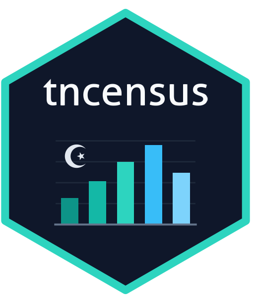

# tncensus 

Unified R data package for Tunisia's General Population and Housing Censuses (**RGPH 2014**, **RGPH 2024**, and the **Harmonized 2014–2024 Delegation Panel**), conducted by the *Institut National de la Statistique* (INS).

## Installation

```r
# Install from GitHub
devtools::install_github("MedDhia/tncensus")
```

## What Is Included

1. **Harmonized 2014–2024 Panel**
   - `census_panel`: 281 delegations × 144 columns (45 socioeconomic indicators with `_2014`, `_2024`, and `_change` suffixes on a 0–100 scale).
   - `delegation_crosswalk`: 263-row crosswalk mapping 2014 delegation names to 2024 equivalents.
   - `codebook`: Metadata for all 45 harmonized indicators.

2. **Full 2014 RGPH (`rgph2014tn`)**
   - `rgph_master`: 264 delegations × 169 variables.
   - `rgph_sheets()` & `rgph_load_sheet()`: 28 disaggregated tables by sex, milieu, and geographic level.
   - `rgph_codebook()`: Variable-level metadata for `rgph_master`.

3. **Full 2024 RGPH (`rgph2024tn`)**
   - `load_delegations()` (279 delegations), `load_governorates()` (24 governorates), `load_national()` (national totals).
   - `download_sectors()` & `load_sectors()` (optional 5,544-row sector-level dataset).
   - `get_governorate()`, `get_delegation()`, `get_sector()`, `get_region()`
   - `list_indicators()`, `search_indicator()`, `rgph2024_codebook()`
   - `gini()`, `theil_decompose()`

4. **RGPH 2004 (`rgph2004`)**
   - 289 rows (264 delegations, 24 governorates, 1 national total) × 54 columns covering population, school enrollment, educational attainment, illiteracy, labour force participation, and unemployment by sex.

5. **RGPH 1984 Education (`rgph1984_education`)**
   - 55,720-row tidy delegation-level dataset covering literacy, educational attainment, and school attendance by sex and age group.

6. **Historical National Education (`historical_education`)**
   - National literacy and 6–14 school enrollment rates across seven census waves (1956–2014).

7. **Historical & Colonial Censuses (1891–1966) & Master Crosswalk**
   - `delegation_codes_ins`: 264-row INS delegation crosswalk linking 1984, contemporary, and UN SALB codes with coordinates.
   - `rgph1966_illiteracy`: 1966 governorate-level illiteracy and male school enrollment rates.
   - `colonial_tunisian_pop` (871 localities, 1926–1956) and `colonial_european_pop` (525 localities, 1891–1936).
   - `colonial_age_caidat_1931` (37 caidats) and `colonial_age_controle_civil_1931` (21 controles civils).

## Data Sources & Acknowledgments

- **2014 & 2024 RGPH and Harmonized Panel:** Original census data published by the *Institut National de la Statistique* (INS), Republic of Tunisia (<https://www.ins.tn/>).
- **Pre-2014 Historical & Colonial Census Data (1891–2004):** Compiled and digitized from `replication_package_ben_salah_al_2024` ([Ben Salah et al., 2024](https://doi.org/10.1016/j.jce.2024.09.002)), covering `rgph2004`, `rgph1984_education`, `rgph1966_illiteracy`, `historical_education` (1956–2014), `delegation_codes_ins`, and the colonial-era census datasets (`colonial_tunisian_pop`, `colonial_european_pop`, `colonial_age_caidat_1931`, `colonial_age_controle_civil_1931`).

8. **Administrative Boundaries (GeoJSON)**
   - `load_geojson()`: Loads `sf` polygon boundaries for `national` (1), `regions` (6), `governorates` (24), and `delegations` (264) from `inst/extdata/geo/*.geojson`.

9. **Historical Geo-Harmonization & Crosswalks**
   - `historical_geonames`: 1,276 historical/colonial place names mapped to modern Tunisian locality names, GeoNames IDs, and coordinates.
   - `delegation_matrix_2014` (264), `delegation_matrix_1984` (198), and `delegation_matrix_merged` (217 time-consistent merged delegations reconciling 1984–2014 splits).
